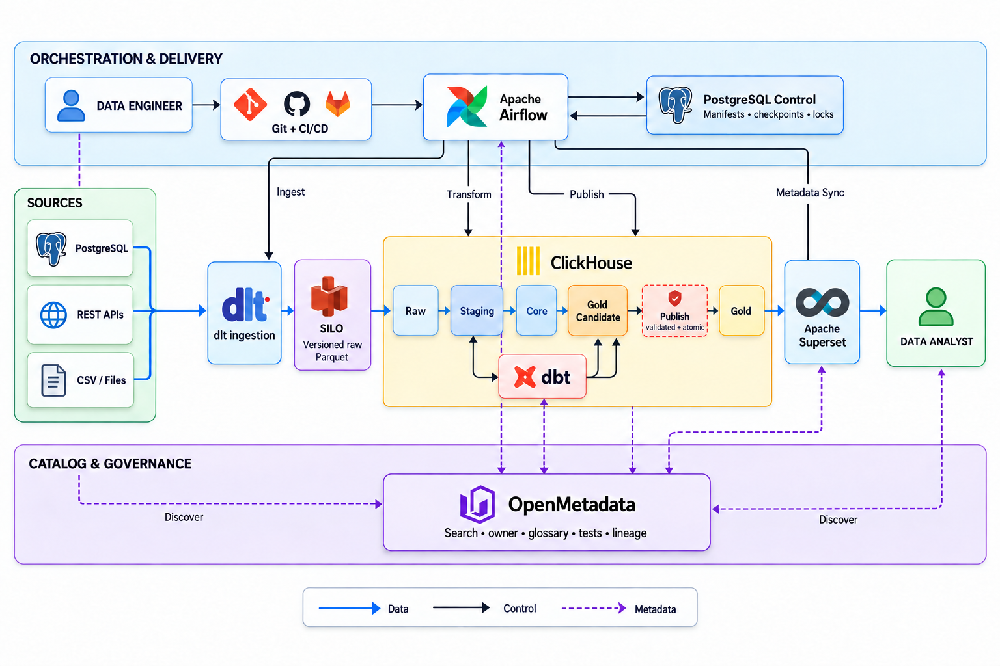

# Kest

Kest is a compact OSS data platform for a small data team. Data engineers add
sources and dbt models; analysts discover governed Gold datasets and build
reports without touching infrastructure. Airflow operates the data path,
OpenMetadata carries context and lineage, and Superset is the analyst surface.



```bash
make up                    # core: Airflow, ClickHouse, SILO, Superset
make credentials           # URLs and local logins
make catalog               # full OpenMetadata UI, lineage and metadata sync
make de DEVELOPER=alice    # isolated dev_alice database and dbt build
make da                    # Superset entry point for analysts
```

The ecommerce data is only an acceptance fixture. `make demo` loads it; normal
startup does not create or schedule demo workload.

Local product surfaces are Airflow on `:8080`, Superset on `:8088`, the SILO
console on `:9001`, ClickHouse diagnostics on `:8123/dashboard`, and
OpenMetadata on `:8585`. Run `make credentials` to print local-only logins.

The supplied deployment is production-disciplined but single-host. It provides
strong database roles, isolated DE databases, immutable versioned raw data,
tested Gold publishing and repeatable recovery; it does not claim HA or
host-loss disaster recovery.
