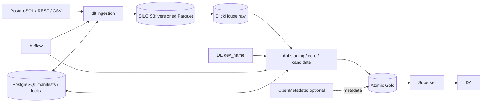

# Architecture and production boundary

The core deliberately has six products to operate: PostgreSQL, Redis, SILO,
ClickHouse, Airflow and Superset. SILO replaces the former four-process
SeaweedFS layout with one S3-compatible service and its full MinIO-style admin
Console. Bucket versioning is enabled; pipeline writer and reader credentials
have separate least-privilege policies, and neither can delete raw objects.

ClickHouse enforces user boundaries: each DE writes only their own database;
DA and Superset read only Gold; the pipeline writes raw/candidate; a separate
publisher exchanges candidate and Gold. PostgreSQL advisory locks serialize
load and publication. Each Gold table is exchanged atomically and keeps three
rollback snapshots.

This is production-standard for a single-host deployment, not HA. It has pinned
artifacts, health checks, least privilege, idempotency, audit manifests,
backups, isolated restore verification and bounded resources. One host, one
PostgreSQL, one ClickHouse and one SILO instance cannot survive host loss.
Backups must be copied off-host for real disaster recovery. Atomicity is per
mart, not across all marts; raw immutability is enforced by application and
access policy, not regulatory object lock.
