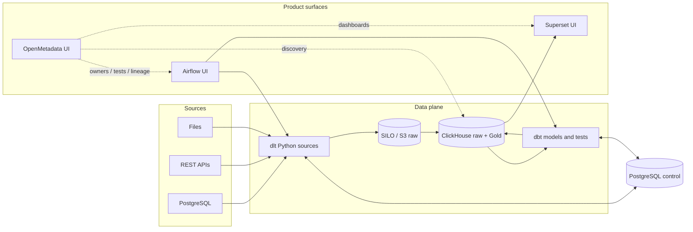

# Current architecture

## What each component is for

| Component | Responsibility | User-facing? |
|---|---|---|
| Airflow 3 | Schedule, retry, pools, run history and backfill parameters | DE/operator UI on `:8080` |
| dlt | Source extraction, incremental state and schema contract | Python/YAML interface for DE |
| SILO | Versioned S3-compatible raw Parquet and recovery objects | Admin console on `:9001` |
| ClickHouse | Raw records, transformations, candidate and Gold serving | SQL; grants enforce personas |
| dbt + Cosmos | Models, tests, documentation and Airflow task graph | DE code and Airflow graph |
| Superset | Analyst exploration and dashboards over Gold | DA UI on `:8088` |
| OpenMetadata | Search, ownership, glossary, tests and lineage | Optional UI on `:8585` |
| PostgreSQL | Airflow/Superset/OpenMetadata state plus Kest manifests and locks | Operator only |
| Redis | Airflow/Superset work queues | Internal only |

Airflow DAGs use the stable `airflow.sdk` interface. Python work executes with
`@task.external_python` in a prebuilt ingestion virtualenv; dbt remains in a
separate virtualenv and is invoked by Cosmos. DAG files declare dependencies;
application logic lives in `ingestion/kest_ingestion/workflows.py` and `ops/`.

## Data and publish guarantees

Every successful extract has a manifest, object checksums and a checkpoint.
The checkpoint advances only after immutable objects and their manifest are
confirmed. Loading is serialized per source/table and deduplicated by
`batch_id`. Raw records carry source time, ingestion time, deletion flag and
record hash.

dbt builds tested tables in `gold_candidate`. Publication takes a PostgreSQL
advisory lock and uses the one-slot Airflow pool before ClickHouse atomically
exchanges one mart into `gold`. It retains three table snapshots for rollback.
Atomicity is per mart, not across the whole dashboard.

## Access boundaries

| Identity | Allowed | Denied |
|---|---|---|
| `de_<name>` | own `dev_<name>`, approved raw/core reads | production Gold writes |
| `pipeline_service` | raw, staging and candidate writes | Gold publication |
| `publish_service` | controlled exchange/rollback | general ingestion |
| `da_readonly` / Superset | Gold selects | insert, alter and drop |
| `metadata_reader` | catalog reads | data mutation |
| `platform_admin` | bootstrap and recovery | normal application use |

## Repository layout

| Path | Contents |
|---|---|
| `ingestion/kest_ingestion` | reusable sources, loader, publish and workflows |
| `ingestion/config`, `templates` | source declarations and the DE source template |
| `transformations` | dbt staging, core, marts, contracts and tests |
| `orchestration/dags` | declarative Airflow Task SDK DAGs only |
| `ops` | host/operator and catalog lifecycle commands |
| `governance` | ownership and OpenMetadata connector configuration |
| `infra` | image definitions and database bootstrap configuration |
| `tests` | unit, integration and backing-service security tests |

## Production boundary

This is a production-disciplined single-host platform, not HA. A host failure
takes out PostgreSQL, ClickHouse and object storage together. Backups on the
same disk prove the recovery procedure but are not disaster recovery until
copied off-host. When one-node limits become material, separate and replicate
stateful services; do not add more orchestration layers to hide the limit.
