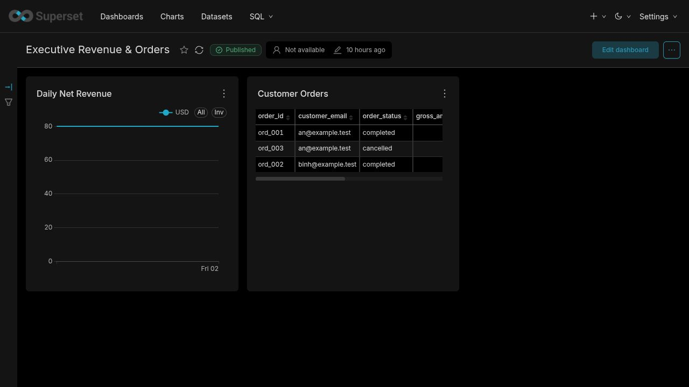

# Data Analyst cookbook

This manual covers the analyst workflow from finding a trustworthy dataset to
publishing a Superset chart. You should not need Docker, Airflow, object-store
or ClickHouse administrator access for routine analysis.

## 1. Start with the two analyst products

Use the products in this order:

1. **OpenMetadata** answers “what data should I use, what does it mean, who
   owns it, is it fresh, and what depends on it?”
2. **Superset** answers “what does the data show, and how do I share the
   analysis?”

Run the local helper:

```bash
make da
```

It prints the Superset URL and local credentials. OpenMetadata is available at
`http://127.0.0.1:8585`. Its bundled local login is documented by
`make credentials`; production must use the organization's SSO/account policy.

Never paste a password into a dashboard description, SQL query, chat message or
ticket. If access fails, ask the platform owner to provision/repair your role
instead of borrowing an administrator account.

## 2. What data is ready for analysis

Use Gold marts by default:

| Dataset | One row represents | Typical questions |
|---|---|---|
| `gold.mart_daily_revenue` | `order_date + currency` | daily captured, refunded and net revenue; paid order count |
| `gold.mart_conversion_funnel` | `event_date + campaign_id` | product views, add-to-cart, checkout, users/sessions and campaign spend |
| `gold.mart_customer_orders` | `order_id` | customer/order status, gross, paid, refunded and net amount |

Gold is a governed interface. Raw and staging tables can change, contain
technical revisions or require delete/deduplication logic. Do not build shared
dashboards directly on them.

The warehouse identity used by Superset is `da_readonly`. It can select Gold
but ClickHouse rejects `INSERT`, `ALTER` and `DROP`. This is intentional: a BI
mistake cannot mutate production data.

## 3. Find and assess a dataset in OpenMetadata

### 3.1 Search

1. Open `http://127.0.0.1:8585`.
2. Select **Explore**.
3. Search for a business phrase (`net revenue`, `conversion`) or exact mart.
4. Prefer an asset in the `gold` schema with an owner and meaningful
   description.
5. Open the asset rather than choosing only by a matching column name.

Example search result for the revenue mart:


The result exposes the canonical definition, Analytics Engineering owner,
`NetRevenue` glossary term and upstream lineage count before you query data.

### 3.2 Read the asset page

Check these fields every time you use an unfamiliar dataset:

| Field | Question it answers |
|---|---|
| Description | What business concept does the table represent? |
| Grain | What does one row represent, and which columns identify it? |
| Owner | Who approves or explains changes? |
| Columns | What are the types, units and nullable fields? |
| Glossary terms | Which definition is canonical across teams? |
| Tests | Which assumptions are continuously checked? |
| Lineage | Where did it come from and which reports consume it? |
| Freshness | How recent should it be? |

Do not infer grain from a sample of unique-looking rows. A grain statement such
as `order_date + currency` is a contract; using only `order_date` in a join can
double-count multi-currency data.

### 3.3 Inspect lineage before changing a shared report

Select the **Lineage** tab on the asset. Work from the selected mart backward to
its source/core tables and forward to dashboards:


Kest guarantees and verifies table-level lineage. Column-level lineage should
only be relied on where the UI actually displays it; absence is not evidence
that a column has no dependency.

### 3.4 Canonical metric meanings

For the supplied marts:

- `captured_revenue`: successful captured payments.
- `refunded_revenue`: successful refunds, including partial refunds.
- `net_revenue`: captured revenue minus successful refunds.
- Late refunds remain attributed to the original order date.
- Retried payments/refunds are deduplicated upstream and must not be summed a
  second time in Superset.
- Funnel stages are based on unique session/user rules implemented in dbt, not
  raw event row counts.

If a requested metric is not present, ask the dataset owner to add it to dbt.
Do not create a second “net revenue” formula in a chart or virtual dataset.

## 4. Use maintained Superset dashboards

Open `http://127.0.0.1:8088`, then select **Dashboards**. Two maintained entry
points are installed:

- **Executive Revenue & Orders**
- **Marketing Funnel & Spend**

The revenue dashboard contains a canonical daily net revenue chart and an
order-level detail table:



### 4.1 Read a dashboard correctly

Before quoting a number:

1. Read the dashboard title and published state.
2. Inspect active native filters, date range, currency and campaign filters.
3. Check the chart subtitle/axis/unit.
4. Hover the point/bar to get the exact value rather than estimating pixels.
5. Confirm the mart and metric definition in OpenMetadata for consequential
   reporting.
6. Record the filter/time context when sharing the result.

A defensible statement looks like: “Gold `net_revenue`, USD, order date
2026-10-02, dashboard refreshed after publication X.” A screenshot with no
filters/date context is not a reproducible analysis.

### 4.2 Refresh versus data freshness

The browser refresh button reruns the dashboard query; it does not ingest new
source data. If a chart remains old after refresh:

1. Check the mart freshness/last update in OpenMetadata.
2. Compare with the expected SLA.
3. If stale, report a data freshness issue to the dataset owner.
4. If fresh, check dashboard filters and cached chart behavior.

Do not repeatedly refresh or widen the query expecting a failed upstream
pipeline to repair itself.

## 5. Explore a governed dataset

### 5.1 Choose the dataset

In Superset, open **Datasets** and select the relevant Gold mart. Use
**Explore** when you want to answer a question visually without editing the
maintained dashboard.

Recommended choices:

- Revenue trend or paid-order count → `mart_daily_revenue`.
- Order/customer detail → `mart_customer_orders`.
- Marketing conversion and spend → `mart_conversion_funnel`.

### 5.2 Build a chart

1. Select a visualization appropriate to the question.
2. Put grain-aligned dimensions in the grouping/time controls.
3. Use existing canonical measure columns.
4. Apply a bounded date filter before running a broad exploration.
5. Run the query and inspect row count/shape.
6. Give the chart a business-readable name that includes the measure and
   breakdown.
7. Save it to a sandbox or reviewed dashboard, according to team policy.

Examples:

| Question | Dataset | Dimension | Measure |
|---|---|---|---|
| How is USD revenue trending daily? | `mart_daily_revenue` | `order_date` | sum of `net_revenue`, filter `currency='USD'` |
| Which orders have refunds? | `mart_customer_orders` | `order_id`, customer/status | `refunded_amount`, `net_amount` |
| Which campaigns lose users before checkout? | `mart_conversion_funnel` | `event_date`, `campaign_id` | canonical stage/user columns |

### 5.3 Aggregation safety

The mart grain determines safe aggregation:

- Summing `net_revenue` across dates/currencies is valid if currencies are not
  combined without conversion.
- Counting rows in `mart_customer_orders` counts orders because its grain is
  one row per `order_id`.
- Do not join two marts directly unless you understand their grains. Joining
  daily revenue to order rows on date alone multiplies values.
- Do not sum already cumulative or ratio columns unless documented as additive.
- Do not silently cast nullable data to zero; null may mean “unknown,” not
  “none.”

When uncertain, use the owner shown in OpenMetadata and include the exact join
and intended grain in your question.

## 6. SQL Lab for read-only analysis

SQL Lab is suitable for validation, ad-hoc segmentation and prototyping. It is
not the place to permanently encode shared business semantics.

Example revenue query:

```sql
SELECT
    order_date,
    currency,
    sum(captured_revenue) AS captured_revenue,
    sum(refunded_revenue) AS refunded_revenue,
    sum(net_revenue) AS net_revenue
FROM gold.mart_daily_revenue
WHERE order_date >= today() - 30
GROUP BY order_date, currency
ORDER BY order_date, currency;
```

Example order validation:

```sql
SELECT
    order_id,
    customer_email,
    order_status,
    gross_amount,
    paid_amount,
    refunded_amount,
    net_amount
FROM gold.mart_customer_orders
WHERE refunded_amount > 0
ORDER BY refunded_amount DESC
LIMIT 100;
```

Query habits:

- select only needed columns;
- always bound exploratory time ranges;
- start with a small `LIMIT` for detail queries;
- avoid `SELECT *` on large tables;
- preserve currency/unit dimensions;
- save reusable business logic as a reviewed dbt request, not nested dashboard
  SQL;
- never request write privileges merely to create a report.

## 7. Add or change a dashboard safely

### 7.1 Decide whether it belongs in a maintained dashboard

Use a sandbox/personal space when the question is exploratory or temporary.
Request review for a maintained dashboard when it is recurring, operational,
executive-facing or used in a decision process.

For review, provide:

- dashboard/chart name and audience;
- linked OpenMetadata dataset;
- metric and dimensions used;
- default filters and timezone;
- expected refresh/freshness;
- screenshot and a validation SQL result;
- owner and deprecation/replacement plan if superseding a chart.

### 7.2 Keep logic in the right place

Allowed in Superset:

- selecting canonical columns;
- aggregating additive measures;
- filtering, grouping and formatting;
- presentation-only labels and chart settings.

Move to dbt:

- payment/refund success semantics;
- deduplication;
- attribution rules;
- funnel stage definitions;
- slowly-changing or latest-record logic;
- reused calculated metrics;
- logic that must match across several dashboards.

This boundary prevents two dashboards from answering the same question with
different formulas.

## 8. Validate before sharing

Use this short reconciliation routine:

1. Run a small SQL Lab query against the same mart/filter range.
2. Compare totals and row counts with the chart.
3. Check currency, timezone and inclusive/exclusive date boundaries.
4. Remove or document any dashboard-only filter.
5. Confirm the owner/definition/freshness in OpenMetadata.
6. Open the dashboard in view mode and verify labels/tooltips.
7. Share the dashboard URL and filter context, not only an image.

For a high-impact number, capture the validation SQL and its time of execution
in the analysis ticket/report.

## 9. Report a data issue effectively

Send the dataset owner one compact, reproducible report:

```text
Dataset: gold.mart_daily_revenue
Dashboard/chart: Executive Revenue & Orders / Daily Net Revenue
Observed at: 2026-10-11 14:20 +07
Filter context: 2026-10-01..2026-10-10, USD
Expected: 180.00 based on <business/source reference>
Actual: 160.00
First affected date: 2026-10-02
Validation SQL: <saved query or short SQL>
OpenMetadata URL: <asset URL>
Screenshot: <attach if useful>
Business impact: <decision/report affected>
```

Avoid “dashboard is wrong” without a dataset, filter context or expected value.
Do not ask an operator to edit Gold manually.

## 10. Common questions

### The dashboard is empty

Clear unexpected filters, confirm the date range, refresh once, then check the
dataset in OpenMetadata. If the mart is fresh but SQL Lab also returns no rows,
contact its owner with the filter context.

### My total is larger than the dashboard

Check duplicated joins, currency grouping, date boundaries and whether you
summed an already aggregated measure. Reproduce using the mart alone before
joining other tables.

### A refund appeared today but changed an older date

That is expected. Revenue attributes late refunds to the original order date,
so historical daily revenue can be restated after controlled processing.

### I need a new metric

Search the glossary and existing marts first. If absent, request a dbt change
with definition, grain, dimensions, examples and intended consumers. Do not
publish a competing dashboard-only formula.

### I cannot write to ClickHouse

Correct: the DA identity is read-only. Create charts/dashboards in Superset or
request a governed model. Production table mutation is not part of DA work.

## 11. Daily and weekly checklist

Daily:

- [ ] Start from OpenMetadata for unfamiliar data.
- [ ] Use Gold marts and canonical metrics.
- [ ] Keep a bounded time range during exploration.
- [ ] Include filter, currency and timezone context when sharing results.
- [ ] Reconcile important charts with a simple SQL query.

Before publishing a shared dashboard:

- [ ] Dataset grain and owner are known.
- [ ] Metric definition matches the glossary/dbt column.
- [ ] No duplicated business formula lives in the chart.
- [ ] Default filters, units, labels and timezone are explicit.
- [ ] Dashboard view mode and permissions were tested.
- [ ] Owner and validation evidence are recorded.

Weekly or before a recurring report:

- [ ] Check freshness and incidents for the source marts.
- [ ] Remove unused drafts and duplicate charts.
- [ ] Confirm maintained dashboard ownership.
- [ ] Raise missing descriptions, owners or glossary mappings as metadata debt.
