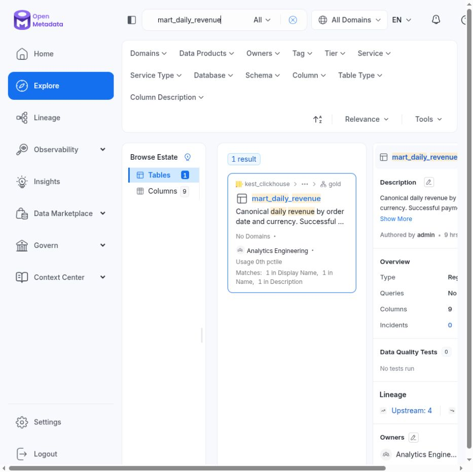
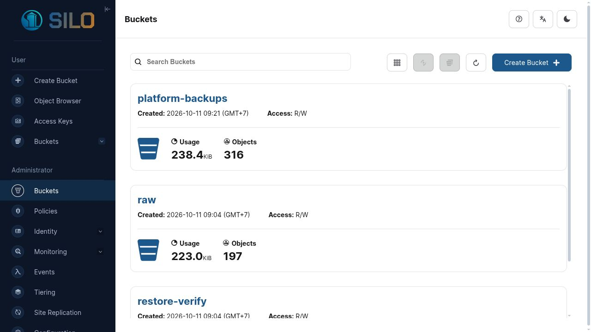
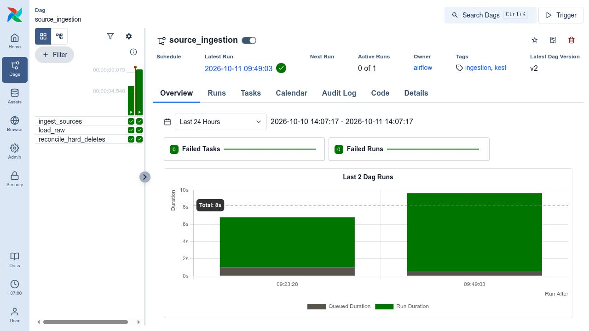
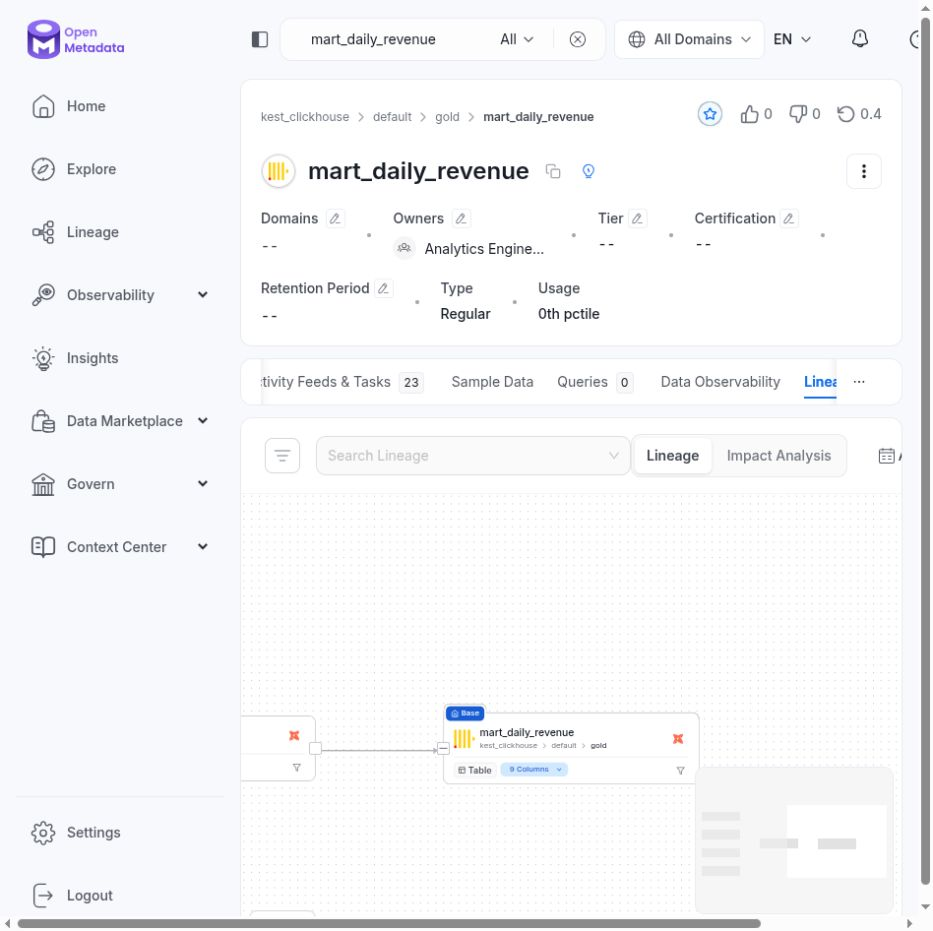
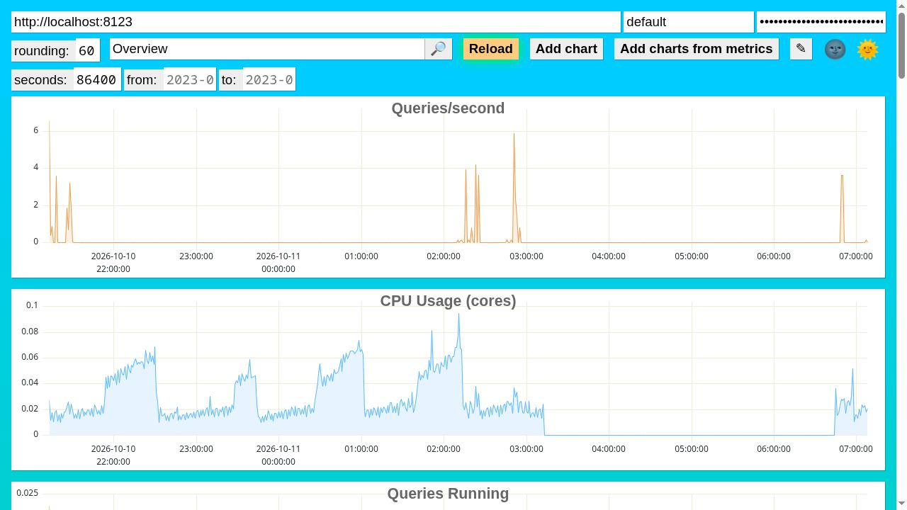

# Data Engineer cookbook

This is the day-to-day manual for engineers who add sources, build dbt models,
operate Airflow runs and publish governed datasets. It intentionally starts
from user actions rather than platform internals.

## 1. Your working contract

A DE owns source configuration, transformations, tests, descriptions and the
operational health of the pipelines they change. A DE does not manually edit
raw objects, write directly to production Gold, reuse an administrator account
for application code, or put business payloads in Airflow XCom.

The normal delivery path is:

```text
feature branch
  → personal ClickHouse database (dev_<name>)
  → pull request and CI
  → staging deployment and candidate build
  → controlled atomic publish
  → Gold marts consumed by Superset
  → metadata sync into OpenMetadata
```

Each developer gets a real database boundary. `dev_alice` and `dev_bob` can
contain different versions of the same model without overwriting each other.
ClickHouse grants—not naming convention—prevent both users from writing Gold.

## 2. First-day setup

### 2.1 Start the products

From the repository root:

```bash
make up
make catalog
make credentials
```

`make up` builds and starts the core services, applies database and object-store
bootstrap, provisions Airflow pools/users and imports Superset assets. It does
not load demo data. `make catalog` starts OpenMetadata, performs a metadata sync
and enables its daily synchronization DAG.

The local URLs are:

| Product | URL | DE use |
|---|---|---|
| Airflow | `http://127.0.0.1:8080` | runs, task logs, retries and backfills |
| OpenMetadata | `http://127.0.0.1:8585` | owners, definitions, tests, impact and lineage |
| Superset | `http://127.0.0.1:8088` | verify the consumer experience after publishing |
| SILO Console | `http://127.0.0.1:9001` | diagnose raw object arrival; operator access only |
| ClickHouse dashboard | `http://127.0.0.1:8123/dashboard` | query/CPU/memory diagnostics |

Use `make credentials`; do not copy generated secrets into Git, a ticket or a
shell-history command. `.env` and `.runtime/` are local-only and ignored by
Git. Production should inject the same variable names from its secret manager.

### 2.2 Create your personal workspace

Run this once, and again safely if you are unsure whether it exists:

```bash
make dev-init DEVELOPER=alice
```

The developer name must match `[a-z][a-z0-9_]{1,31}`. The command creates:

- ClickHouse database `dev_alice`;
- ClickHouse user `de_alice`;
- a random password in `.runtime/developers/alice.env` with mode `0600`;
- grants for the personal database and approved raw/core reads;
- an explicit denial path for production Gold writes.

Build the complete dbt project in that workspace:

```bash
make dbt-build DEVELOPER=alice
```

A healthy initial result ends with all models and tests passing. The current
acceptance fixture runs 25 dbt nodes. A different count after adding a model is
normal; a failure is not.

## 3. Repository map for DE work

| Path | Change it when |
|---|---|
| `ingestion/config/` | registering a real source instance |
| `ingestion/templates/rest_source.yml` | changing the supported REST template for everyone |
| `ingestion/kest_ingestion/` | changing shared extraction, manifest, loader or publishing behavior |
| `transformations/models/staging/` | typing, renaming and cleaning raw records |
| `transformations/models/core/` | creating reusable business entities |
| `transformations/models/marts/` | exposing a governed analyst-facing dataset |
| `transformations/tests/` | adding cross-row or cross-table assertions |
| `orchestration/dags/` | declaring dependencies, schedule, pools and parameters only |
| `governance/ownership.yml` | assigning dataset ownership and glossary metadata |
| `tests/` | proving contracts, idempotency, RBAC and integration behavior |

Keep application logic out of DAG files. DAGs should tell Airflow what depends
on what; extraction, loading, validation and publishing logic belongs in the
ingestion package or `ops/`.

## 4. Daily model development

### 4.1 Before changing SQL

1. Pull the current protected branch and create a feature branch.
2. Search the target mart in OpenMetadata.
3. Read its description, owner, glossary terms, columns and upstream lineage.
4. Open linked Superset dashboards and identify visible consumers.
5. Write down the intended grain and which historical partitions can change.

Searching `mart_daily_revenue` returns the canonical definition, owner,
`NetRevenue` glossary term and upstream count:



Do this before editing a shared mart. It is faster than discovering a broken
dashboard after publication.

### 4.2 Model layers

Use each layer for one purpose:

- `staging`: one source-shaped model; type conversion, naming, nullable handling
  and latest-revision selection. Do not add dashboard-specific business rules.
- `core`: reusable entities and financial/event semantics shared by marts.
- `marts`: stable grain and canonical measures intended for DA consumption.

Every mart must document:

- one sentence saying what a row represents;
- the exact grain and stable grain key;
- owner/team;
- canonical metric columns and units;
- freshness expectation;
- accepted/null/unique/relationship tests as applicable;
- any intentional handling of late arrivals or deletes.

### 4.3 Build and inspect

Edit SQL/YAML, then run:

```bash
make dbt-build DEVELOPER=alice
```

The command reads your generated credential file and targets `dev_alice`. It
does not publish production data. During iteration, inspect the database with a
read-only query from inside the existing ClickHouse container:

```bash
set -a
source .runtime/developers/alice.env
set +a
docker compose exec clickhouse clickhouse-client \
  --user de_alice \
  --password "$DBT_DEV_PASSWORD" \
  --database dev_alice \
  --query "SELECT * FROM mart_daily_revenue ORDER BY order_date, currency LIMIT 20"
unset DBT_DEV_PASSWORD
```

Avoid putting the password directly in the command. Remember that the shell
history can persist literal arguments.

### 4.4 Required review checks

Before opening a pull request:

```bash
make lint
make type
make test-unit
make dbt-build DEVELOPER=alice
git diff --check
```

For a change touching ingestion, publishing, roles or object storage, also run
the stack-backed checks:

```bash
make test-integration
make smoke
make health
```

Your pull request should state:

- the changed source/model and its grain;
- whether the schema change is additive or breaking;
- affected dashboards or downstream marts from OpenMetadata lineage;
- tests added or changed;
- backfill window, if historical data must be rebuilt;
- a validation query and expected result;
- rollback approach.

## 5. Add a REST source without new orchestration

For a standard cursor-paginated endpoint:

```bash
make source-new \
  SOURCE=crm_customers \
  BASE_URL=https://crm.example/api \
  ENDPOINT=/customers \
  TABLE=customers \
  PRIMARY_KEY=customer_id
```

This creates `ingestion/config/crm_customers.yml` and validates it with the
same Pydantic contract used at runtime. Review at least:

```yaml
name: crm_customers
base_url: https://crm.example/api
endpoint: /customers
table_name: customers
primary_key: customer_id
updated_at: updated_at
data_path: items
cursor_param: cursor
next_cursor_path: next_cursor
page_size: 100
timeout_seconds: 10
max_retries: 4
```

Then:

1. Put credentials in the environment/secret manager, never in YAML.
2. Confirm `data_path` and `next_cursor_path` against a captured response.
3. Confirm the API supports a stable primary key and incremental timestamp.
4. Run `make lint` so all source configurations are validated.
5. Run the ingestion in dev/staging and inspect its manifest/object checksums.
6. Add a typed staging model and tests before offering the data to analysts.
7. Add ownership and description metadata.

The generic source runner handles retries, `Retry-After`, checkpoints and raw
landing. Do not create a separate DAG for every ordinary REST endpoint. Write a
reviewed adapter only when authentication, pagination or response semantics do
not fit the supported template.

## 6. Understand the ingestion boundary

A successful batch follows this order:

1. Read source pages/rows inside the configured lookback window.
2. Write immutable Parquet objects under a batch-specific S3 prefix.
3. Verify every object size and checksum.
4. Commit the batch manifest.
5. Advance the source checkpoint only after the manifest is valid.
6. Load into ClickHouse staging under a source/table advisory lock.
7. Verify count/checksum and insert with `batch_id` deduplication.

If a page times out or returns `429`, the checkpoint must not advance. Replaying
an already completed batch is a no-op. Soft deletes use `is_deleted`; a periodic
reconciliation emits audited tombstones for supported hard-delete detection.

SILO is an operator/diagnostic surface, not an editing tool. The `raw` bucket is
versioned and application policy prevents the writer identity from deleting
objects. Never “fix” a pipeline by replacing a Parquet file in the console.



## 7. Operate Airflow

The platform exposes five DAGs:

| DAG | Use |
|---|---|
| `source_ingestion` | extract, load raw and reconcile deletes |
| `transform_publish` | build tested candidates and publish each Gold mart |
| `ecommerce_end_to_end` | combined acceptance path; unscheduled until a source owner approves an SLA |
| `controlled_backfill` | validated, serialized historical replay |
| `metadata_sync` | daily OpenMetadata synchronization |

The `source_ingestion` grid shows the three data-boundary tasks and previous
successful runs:



### 7.1 Read a run

1. Open the DAG and select the latest run.
2. Green means success; red means failure; yellow means running/retrying.
3. Select the failed task, then open its logs.
4. Record the run ID, task ID and any printed batch ID.
5. Identify whether failure is source, storage, loader, dbt test or publish.
6. Check `make health` before retrying a dependency-related failure.

Only identifiers appear in XCom. Data lives in SILO/ClickHouse, so never debug
by expecting an API response or a record list in XCom.

### 7.2 Retry safely

Retry transient extraction or load failures from the failed task. Checkpoint
and batch deduplication make these retries safe. Do not clear a failed candidate
test and manually invoke publishing: a failed candidate is intentionally not
production data.

After a retry, confirm:

- the task and DAG run are green;
- only one completed manifest exists for that batch identity;
- the Gold publication ID changed only if a publish actually occurred;
- the validation query and affected dashboard agree.

### 7.3 Controlled backfill

Trigger `controlled_backfill` and supply:

| Parameter | Rule |
|---|---|
| `source` | `postgres`, `campaigns`, `campaign_spend` or `product_catalog` |
| `start` | required ISO date |
| `end` | required ISO date; not in the future |
| `reason` | at least three characters; use an incident/change reference |
| `dry_run` | keep `true` first; set `false` only after reviewing the plan |

The local policy rejects inverted ranges, future dates and windows longer than
366 days. Backfills use the `heavy_backfill` pool and cannot consume all
analyst-facing capacity. After a real run, verify the corrected partition,
publication manifest and dashboard result.

## 8. Publish and rollback expectations

Production dbt builds target `gold_candidate`. Publishing:

1. validates candidate tests;
2. takes a dataset advisory lock;
3. consumes the one-slot `gold_publish` Airflow pool;
4. atomically exchanges one candidate table with its Gold table;
5. records the publication manifest;
6. retains three old table versions as rollback snapshots.

Atomicity is per mart, not across all three marts. If a dashboard reads several
marts during publication, it can briefly observe different publication IDs.
The `pipeline_service` cannot publish; only `publish_service` has the minimum
exchange privileges.

For rollback, do not rename tables manually. Give the operator the mart,
publication ID, reason and validation query so the retained snapshot is
restored through the controlled publisher identity.

## 9. Use OpenMetadata for impact analysis

On a table page, inspect the `Columns`, `Lineage`, `dbt` and data-quality areas.
The lineage view is the fastest way to see whether a staging/core change feeds
a shared Gold mart or dashboard:



After a merged change and metadata synchronization, confirm:

- the table and all expected columns are present;
- description and owner are not empty;
- glossary terms point to the intended canonical metrics;
- dbt test cases are attached;
- upstream/downstream table lineage exists;
- Superset dashboards are discoverable.

Kest currently verifies table-level lineage. Do not promise column lineage
unless the connector has actually produced and the verification has checked it.

## 10. Diagnose capacity without guessing

Open ClickHouse's built-in dashboard for query rate, CPU, memory, disk reads,
selected rows and merge activity:



During a slow backfill or dashboard complaint, compare:

- query duration and rows/bytes read in `system.query_log`;
- concurrent queries and active merges;
- tracked memory and filesystem/disk reads;
- Airflow pool occupancy;
- whether a heavy task used the correct service user and pool.

Do not solve contention by granting DAs a larger unrestricted profile. Tune the
model/query, partition the rebuild, or move heavy work into its bounded pool.

## 11. Common incidents

### REST timeout or 429

Check retry logs and `Retry-After`, verify the checkpoint did not move, restore
the endpoint and retry the failed task. Confirm that exactly one valid batch is
completed afterward.

### Breaking schema

Keep the batch quarantined, compare the source payload with its contract,
classify the change, update staging/tests in a reviewed PR, then replay. Do not
relax the contract merely to make the run green.

### Late refund or event

Confirm it falls inside the lookback/rebuild policy. Run a dry backfill for the
source date range, then a real backfill. Revenue must be corrected on the
original order date, not the refund arrival date.

### Candidate dbt test failure

Stop. Production Gold and its publication ID should remain unchanged. Fix the
model or test expectation in a developer database and rerun the candidate.

### Dashboard result disagrees with SQL

Confirm both read the same Gold mart/publication, remove duplicated business
logic from the chart, refresh the dataset metadata/cache, and attach the exact
filter/time range when escalating.

## 12. End-of-change checklist

- [ ] Personal database build passes.
- [ ] Grain, owner, descriptions and freshness are documented.
- [ ] Tests cover keys, nulls, relationships and business invariants.
- [ ] Source change preserves checkpoints and idempotent replay.
- [ ] OpenMetadata impact and Superset consumers were reviewed.
- [ ] CI and staging acceptance pass on the same Git SHA.
- [ ] Backfill begins with `dry_run=true` when history changes.
- [ ] Production publication uses the publisher path, never a DE account.
- [ ] Post-publish SQL, dashboard and metadata checks pass.
- [ ] Rollback target/publication ID is known.
