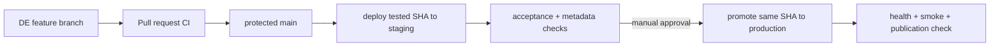

# Environments and delivery

Dev, staging and production are deployments, not three schemas in one
ClickHouse server.

| Environment | Purpose | Data | Deployment |
|---|---|---|---|
| Developer | fast model/source iteration | synthetic or approved masked data; `dev_<name>` per DE | laptop or shared dev host |
| Staging | integration, migration and release acceptance | representative masked subset | dedicated Compose project/host and secrets |
| Production | scheduled pipelines and DA workloads | production data | dedicated host, volumes and secret store |

Use a different `COMPOSE_PROJECT_NAME`, `.env`, DNS/ports and persistent volumes
for each deployment. Staging and production should not coexist on the same
Docker host: project names isolate objects but not CPU, kernel, disk or failure
domain. Image tags and digests stay identical during staging-to-production
promotion; configuration and secrets are the only intended differences.

## Git and CI/CD flow

The repository currently implements CI in `.github/workflows/ci.yml`; it does
not pretend to deploy anywhere. A production CD job should run on a dedicated
self-hosted runner or through the organization's deployment tool:

1. Build the Airflow, tooling and Superset images once; scan and publish them
   under the Git SHA.
2. Deploy that SHA to staging, run `make up`, migrations, unit/integration/RBAC
   tests, `make pipeline`, `make smoke` and optionally `make catalog`.
3. Require an approval through GitHub Environments, GitLab protected
   environments, Argo CD or the equivalent Jenkins gate.
4. Promote the exact image digests to production. Run migrations/init jobs,
   then `make health`; enable schedules only after the checks pass.
5. Record commit, image digests, command output and publication IDs. Roll back
   application images by SHA and Gold data by its retained publication snapshot.

For `main`, require pull requests, CODEOWNERS approval, successful `static` and
`core-integration` checks, resolved discussions, no force-push and restricted
administrator bypass. CODEOWNERS alone is not enforcement.

## Configuration ownership

- Git contains topology, source/model contracts and `.env.example`, never live
  credentials.
- Local `make bootstrap-env` creates mode-`0600` credentials for evaluation.
- Staging/production inject equivalent variables from Vault, a cloud secret
  manager or CI protected secrets; they do not reuse local `.env` values.
- Production OpenMetadata should use SSO and production Airflow/Superset should
  sit behind the organization's TLS ingress. Only explicitly required ports
  are bound, and the supplied local Compose binds them to `127.0.0.1`.
- Database migrations and object-store policies run as controlled init jobs.
  DE/DA identities never receive bootstrap credentials.
